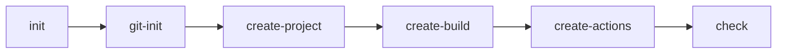

# Архітектура AI-агента

## Проблема, яку вирішує агент

Під час початкового налаштування Rust-проєкту потрібно узгоджено створити
структуру Cargo, вихідний код, тест, локальні CI-скрипти та workflow GitHub
Actions для трьох операційних систем. Агент `build-engineer` стандартизує цей
процес, перевіряє результат і зупиняється на першій помилці, не приховуючи
проблеми автоматичними виправленнями.

## Skills

| Skill | Входи | Виходи |
|---|---|---|
| `project-scaffold` | Назва проєкту `hello`, мова Rust | Структура Cargo-проєкту, вихідний код Hello World і тест `BasicAddition` |
| `build-and-test` | Структура Cargo-проєкту, команди Cargo | `ci.sh`, `ci.bat`, результати `cargo build --release` і `cargo test` |
| `github-actions` | Проєкт, локальні CI-кроки, вимоги до платформ | Workflow `ci.yml` для `ubuntu-latest`, `windows-latest` і `macos-latest` |

## Commands

| Command | Шлях | Передумови | Результат |
|---|---|---|---|
| `git-init` | `.github/prompts/git-init.prompt.md` | Відкрито репозиторій або каталог проєкту | Перевірено Git-репозиторій і підготовлено базову конфігурацію без знищення наявних змін |
| `create-project` | `.github/prompts/create-project.prompt.md` | Виконано `git-init`, визначено назву `hello` і мову Rust | Створено структуру Cargo та код проєкту |
| `create-build` | `.github/prompts/create-build.prompt.md` | Виконано `create-project` | Створено тест `BasicAddition` і локальні CI-скрипти |
| `create-actions` | `.github/prompts/create-actions.prompt.md` | Виконано `create-build` | Створено workflow GitHub Actions із матрицею Windows, Linux і macOS |
| `check` | `.github/prompts/check.prompt.md` | Створено всі артефакти попередніх етапів | Перевірено збірку, тест, YAML, `.gitignore` та повернуто звіт `PASS` або `FAIL` |
| `init` | `.github/prompts/init.prompt.md` | Доступний агент у Copilot Chat | Послідовно запущено весь процес: `git-init` → `create-project` → `create-build` → `create-actions` → `check` |

## Дані, що передаються між етапами

- назва проєкту: `hello`;
- мова програмування: Rust;
- шляхи файлів: `Cargo.toml`, `src/main.rs`, `ci.sh`, `ci.bat`,
  `.github/workflows/ci.yml`, `.gitignore`;
- код повернення перевірок: `0` для успіху та ненульове значення для помилки;
- результати попередніх етапів передаються наступному етапу як факт створення
  файлів і статус виконання команд.

## Обробка помилок оркестратором

Оркестратор зупиняє виконання на першій помилці. Після кожного етапу він
формує явний звіт `PASS` або `FAIL`, додає код повернення та повідомлення
команди. Приховані виправлення, ігнорування помилок і продовження процесу після
невдалого обов'язкового кроку заборонені.

## Відповідність «файл → роль»

| Файл або каталог | Роль |
|---|---|
| `.github/agents/build-engineer.agent.md` | Manifest і правила роботи агента |
| `.github/prompts/*.prompt.md` | Визначення команд агента |
| `.github/skills/*/SKILL.md` | Інструкції спеціалізованих skills |
| `docs/architecture.md` | Опис архітектури, потоків даних і помилок |
| `docs/ai-log.md` | Журнал взаємодії з AI та прийнятих рішень |
| `.gitignore` | Виключення артефактів збірки та локальних секретів із Git |

Copilot використовує `.github/agents/*.agent.md` для опису агента,
`.github/prompts/*.prompt.md` для commands і `.github/skills/*/SKILL.md` для
skills.

## Схема взаємодії

